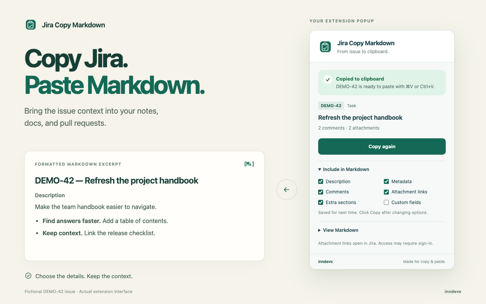

# Jira Copy Markdown

Copy the Jira issue you have open as Markdown. Use the result in notes, documents, pull requests, or other places that accept plain text.

Jira Copy Markdown is an independent, open-source browser extension by [inndevs](https://github.com/inndevs). It is not affiliated with or endorsed by Atlassian.



## Use

1. Open a Jira issue over HTTPS in Chrome and sign in to Jira as usual.
2. Click the Jira Copy Markdown extension. It reads the issue and copies Markdown automatically.
3. Paste the result where you need it.

To change the output, expand **Include in Markdown**, adjust the options, and click **Copy Markdown**. Description, metadata, comments, attachment links, and extra sections are included by default; custom fields are optional. Preferences are remembered for the next export. You can inspect the generated text under **View Markdown** and copy it manually if clipboard access fails.

The extension reads the issue when you open its popup. It first requests issue data from that Jira site's REST API using your existing session. If the API is unavailable, it tries the content rendered on the page. Page-based exports can omit content that has not loaded or is hidden. Jira versions and custom page layouts can differ, so review the output before sharing it. Warnings in the popup identify incomplete results, including comment retrieval limits.

Attachments are included as links. The extension does not download attachment files, and anyone opening those links still needs the appropriate Jira access.

## Install from source

1. Download this repository or clone it:

   ```sh
   git clone https://github.com/inndevs/jira-copy-markdown.git
   cd jira-copy-markdown
   ```

2. Open `chrome://extensions` in Chrome and enable **Developer mode**.
3. Select **Load unpacked** and choose the repository folder containing `manifest.json`.
4. Pin the extension if you want quick access from the toolbar.

No dependency installation or build step is needed to load the source. After changing the code, reload the extension on `chrome://extensions`.

## Privacy and permissions

Issue text, comments, names, and the current issue URL are processed in your browser to create the requested export. Issue content is not sent to inndevs, analytics services, or AI services. Requests for issue data go to the Jira site you are using. Your export preferences are saved locally; the resulting Markdown goes to your operating system clipboard.

| Permission | Purpose |
| --- | --- |
| `activeTab` | Temporarily access the tab where you invoke the extension. |
| `scripting` | Run the issue reader when you invoke the extension. |
| `storage` | Remember export preferences in local browser storage. |
| `clipboardWrite` | Copy the generated Markdown to the clipboard. |

There is no background collection, broad host permission, telemetry, or remotely loaded executable code. See the [privacy policy](PRIVACY.md) for details.

## Develop and package

Run the tests with a current Node.js release:

```sh
npm test
```

Run the browser integration checks in an isolated headless Chrome profile:

```sh
npm run test:browser
```

Set `CHROME_BIN` if Chrome is not at its standard macOS location. The browser checks use fictional Jira responses and do not use your signed-in profile.

Create a distributable ZIP with Python 3:

```sh
python3 scripts/package.py
```

The packager validates the extension's local file references and includes only the explicit runtime file list. It writes `dist/jira-copy-markdown-VERSION.zip`, using the version in `manifest.json`. Identical inputs and the same Python/zlib toolchain produce identical ZIP bytes. Tests, documentation, repository metadata, and development files are excluded. The packager uses only Python's standard library.

For manual verification, load the extension and copy a test issue containing formatted text, a comment, and an attachment link. Check the pasted Markdown, the content options, the missing-issue message on a non-Jira page, and the fallback behavior when the Jira API is unavailable. Use fictional test data for screenshots and bug reports.

## Support and license

Report reproducible problems in [GitHub Issues](https://github.com/inndevs/jira-copy-markdown/issues). Include your browser version, Jira deployment type, and a minimal example with private information removed.

Released under the [MIT License](LICENSE).
